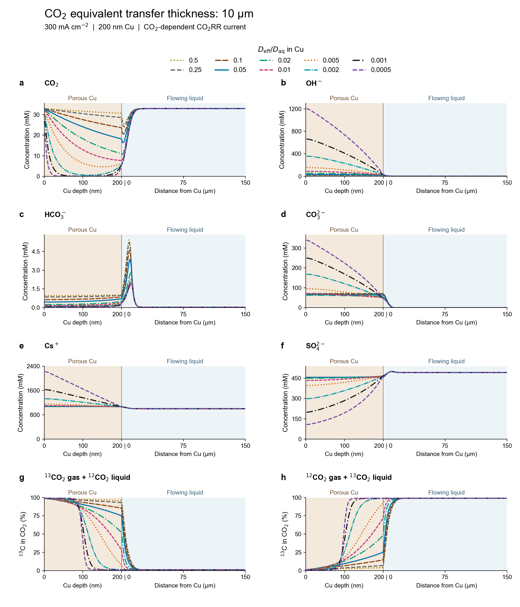

# CO2RR spatial reaction–transport model

Reproducible calculations for CO₂, dissolved inorganic carbon (DIC), free OH⁻,
electrolyte ions and carbon-isotope source fractions across an idealized
**200 nm aqueous-connected Cu catalyst path and the adjacent flowing liquid**.
This is the spatial calculation supporting manuscript Figure 4 and the
10/30/50 µm external-transfer sensitivity figures (Figures S71–S73 in the
associated supporting information). It is separate from the
[active-learning repository](https://github.com/Wang-Group/CO2RR-Phosphine-Modified-Cu).

## Start here

Python 3.10 is the tested interpreter. From the repository root:

```sh
python -m pip install -r requirements.txt
python validate_release.py
python model/test_species_transfer.py
python plot_results.py --results results --out runs/redrawn_profiles
python postprocess.py --results results --out derived
python figure4/code/redraw_figure4.py
```

The first command after installation checks all 36 archived cases and their raw
states against the released equations, without changing them. The contract test
checks source integrals, the nonlocal Jacobian and passive transfer benchmarks.
The plotting commands use saved numerical outputs; they do not refit the model.
The Figure 4 command produces PNG/SVG and separately editable panels; add
`--pdf` only if PDF export is needed. The schematic is an illustration, not a
measured pore reconstruction.



## Run new calculations

```sh
# Short numerical smoke test, not a production-resolution prediction:
python model/species_transfer_model.py --delta 10 --chi 0.25 --nc 6 --ny 48 --nx 4 --out runs/smoke

# One production-resolution case:
python model/species_transfer_model.py --delta 10 --chi 0.25 --out runs/d10_chi0p25

# Full 30-case screen, optionally plus six verification cases:
python run_screen.py --out runs/new_screen --workers 2 --verification
```

The screen runner refuses a nonempty output directory. Use a new output path;
do not overwrite `results/`. A full rerun may take hours. The base modules
`current_constrained_model.py` and `corrected_numerics.py` are implementation
dependencies: **use `species_transfer_model.py` as the calculation entry point**.

## What is specified, and what is predicted?

* Prescribed: 300 mA cm⁻², mean conventional CO₂RR Faradaic efficiencies, a
  200 nm liquid-connected path, ideal reservoir chemistry, and transport scenarios.
* Screened: CO₂ passive equivalent transfer length δ = **10, 30, 50 µm** and
  geometric effective diffusivity ratio χ = **0.5, 0.25, 0.1, 0.05, 0.02, 0.01,
  0.005, 0.002, 0.001, 0.0005**.
* Solved: coupled transverse diffusion/electromigration, axial convection,
  finite reversible CO₂–DIC conversion, charge/speciation closure, current and
  carbon balance, and complementary gas-/liquid-carbon-source transport.
* Not fitted: there is no electrochemical rate calibration against a reference
  diffusivity or isotope result. CO₂ weighting of the spatial carbon sink is an
  explicit assumption normalized to the measured total carbon-consumption rate.
* Not predicted: independent product selectivities, molecular intermediates,
  pore wetting morphology, moving menisci, or a unique product-generation depth.
  The same carbon-current weighting is used for all carbon products.

**δ is D/k, not a physical liquid-film boundary.** Each species has a different
passive transfer-equivalent length in a common 500 µm numerical liquid domain.
The enhanced effective shear used to realize the scenarios is **not** the actual
cell velocity. Smooth-wall geometry at 10 mL min⁻¹ gives approximately 108 µm;
10/30/50 µm are assumed enhanced-transfer sensitivities, not measured values.

## Contents and provenance

| Directory/file | Role |
|---|---|
| `model/` | Audited solver and contract checks |
| `fe_audit/faradaic_inputs.csv` | Three FE replicates, means, stoichiometry and derived fluxes; sole external scientific runtime input |
| `results/cases/` | 30 production cases + 3 finer-grid + 3 larger-domain checks, including raw restart arrays and axial/mean CSVs |
| `results/case_index.json` | Explicit case list and verification type |
| `figure4/` | Figure source CSVs, column dictionary and the existing redraw scripts |
| `docs/MODEL.md` | Equations, coordinates, boundary conditions and interpretation |
| `docs/PARAMETERS.md` | Measured, literature, derived and assumed inputs, including uncertainties in provenance |
| `provenance/` | Parameter ledger, original input hashes, import history and release checksums |
| `docs/VALIDATION.md` | Numerical acceptance, known limitations and archived-data qualifications |

The original four campaign-input hashes match the local calculation archive.
Release changes are limited to portability, metadata redaction, documentation
and standalone tools; see [the release notes](docs/RELEASE_NOTES.md).
No raw experimental archives, manuscript files, literature PDFs, correspondence,
credentials, absolute workstation paths or unrelated project files are included.

## Important limitations

Ideal activities and dilute-aqueous diffusivities are used in a concentrated
electrolyte. Absolute OH⁻/DIC concentrations are hypotheses, not validated local
measurements. All saved cases passed the recorded numerical acceptance gates;
mesh/domain checks cover **χ = 0.05 only**, not every low-χ case. Low-CO₂ points
are retained, including depleted external-liquid cells with relatively larger
isotope reconstruction error. Read [validation and limitations](docs/VALIDATION.md)
before using these results.

